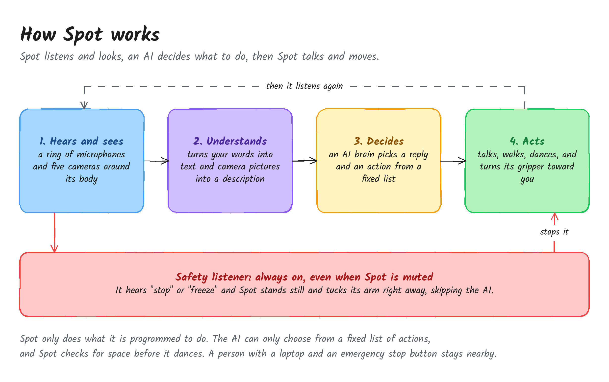
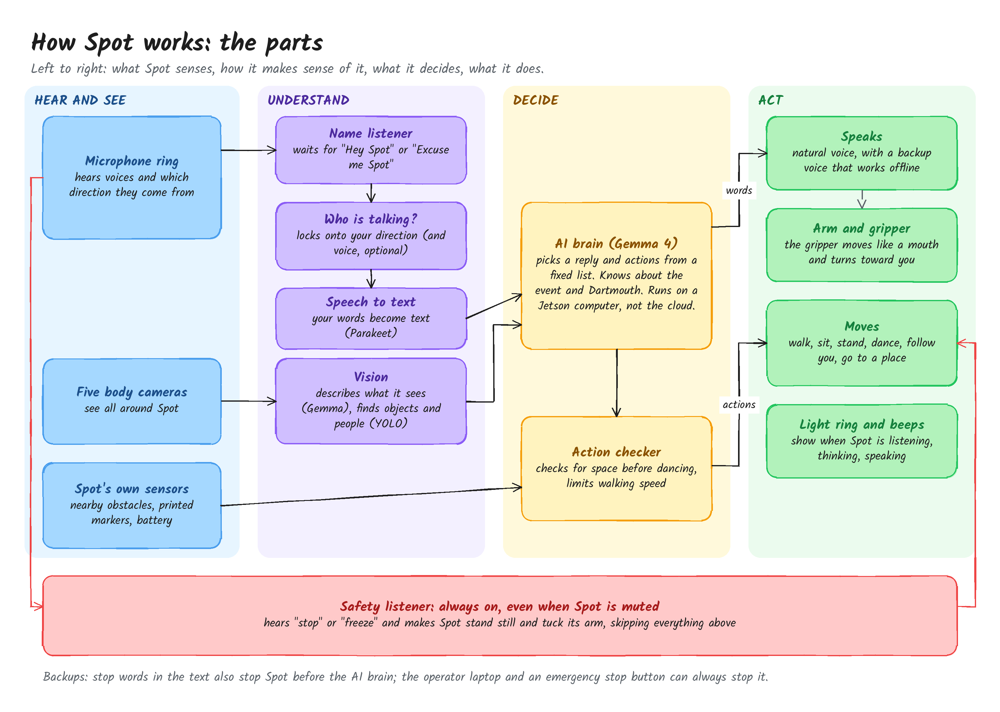
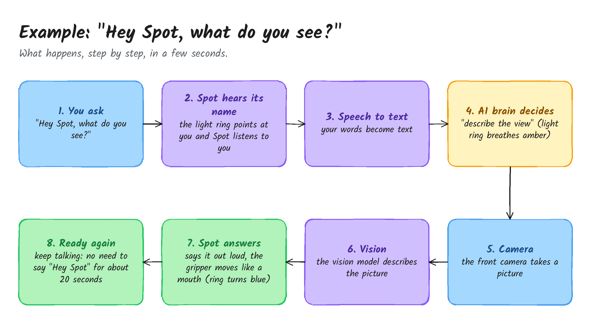
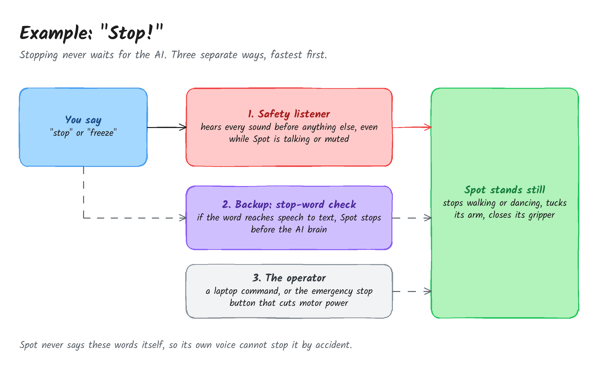

# How Spot Works

A plain-English tour of the voice-controlled Spot, from "big picture" down to "what happens when you talk to it". Engineers who want every model, port and file should go to the [full system diagram](system-diagram.md) and the [pipeline explainer](pipeline-explainer.md).

## In one sentence

Spot listens and looks, an AI decides what to do, then Spot talks and moves, and a separate safety listener can always make it stop.

## The parts

Read left to right: what Spot senses, how it makes sense of it, what it decides, and what it does. The red lane at the bottom works on its own, beside everything else.

| Part | What it does, plainly | Technical name |
|---|---|---|
| Microphone ring | Hears voices and which direction they come from; its lights show what Spot is doing | reSpeaker XVF3800 |
| Five body cameras | See all around Spot | Spot fisheye cameras |
| Spot's own sensors | Know about nearby obstacles, printed markers and the battery | Spot LocalGrid, AprilTags, robot state |
| Name listener | Waits for "Hey Spot" or "Excuse me Spot" | sherpa-onnx keyword spotter |
| Who is talking? | Locks onto the person who said the name, by direction (and, optionally, voice) | DoA speaker lock, WeSpeaker voiceprint |
| Speech to text | Turns your words into text | Parakeet ASR |
| Vision | Describes what the camera sees; finds objects and people | Gemma 4 vision, YOLO-World, YOLOv8n |
| AI brain | Picks a reply and actions from a fixed list; knows about the event and Dartmouth | Gemma 4 E4B on llama.cpp, on a Jetson AGX Orin |
| Action checker | Checks for space before dancing, limits walking speed | dispatcher (`spot_dispatch.py`) |
| Speaks | Natural voice, with a backup voice that works offline | ElevenLabs, Kokoro |
| Arm and gripper | The gripper moves like a mouth and turns toward you | Spot Arm |
| Light ring and beeps | Show when Spot is listening, thinking, speaking | XVF3800 LED ring, chimes |
| Safety listener | Always listening for "stop" or "freeze", even when muted | always-on safety keyword spotter |

## Example 1: "Hey Spot, what do you see?"

1. You ask "Hey Spot, what do you see?" in one breath.
2. Spot hears its name. The light ring sweeps toward you and Spot locks onto your direction.
3. Your words become text.
4. The AI brain decides the right action is "describe the view". The ring breathes amber while it thinks.
5. The front camera takes a picture.
6. The vision model describes the picture.
7. Spot says the answer out loud; the gripper moves like a mouth and the ring turns blue.
8. For about 20 seconds you can keep talking without saying "Hey Spot" again. Someone else takes over only by saying the name.

## Example 2: "Stop!"

Stopping never waits for the AI. There are three separate ways, fastest first:

1. **Safety listener.** It hears every sound before anything else, even while Spot is talking or muted. On "stop" or "freeze", Spot stops walking or dancing, tucks its arm and closes its gripper.
2. **Stop-word check.** If the word still reaches speech to text, Spot stops before the AI brain sees it.
3. **The operator.** A command from the laptop, or the emergency stop button, which cuts motor power.

Spot never says these words itself, so its own voice cannot set them off.

## Things worth knowing

- **Spot only does what it is programmed to do.** The AI can only pick from a fixed list of actions (walk, sit, dance, describe, and so on); it cannot invent new ones.
- **Most of the thinking happens locally, not in the cloud.** Speech to text, the AI brain and vision run on a Jetson computer. Only the natural voice uses the internet, and a backup voice takes over if the connection drops.
- **It checks before it moves.** No dancing within about a metre of an obstacle, and walking is speed-limited.

## Paragraph for Spot to say

Ready for the `## How Spot works` slot in `src/voice_control/knowledge/event_knowledge.md` at the next event. It avoids the safety words on purpose, because Spot reads this pack and its own voice must never say them. It is not in the pack yet: filling any slot turns the pack on as "you are at the event", so fill it together with the event details.

> Spot listens and looks, an AI decides what to do, then Spot talks and moves. A ring of microphones hears your voice and which direction it comes from. When you say "Hey Spot", Spot locks onto you and turns your words into text. An AI language model, Gemma, running on a local Jetson computer rather than in the cloud, picks a reply and an action from a fixed list, such as walking, sitting, dancing or describing what its camera sees. Spot then speaks, and its gripper moves like a mouth while it talks. A light ring shows when Spot is listening, thinking or speaking. A separate safety listener runs all the time, even when Spot is muted, and can make Spot stand still instantly without waiting for the AI.

## Editing the diagrams

The pictures come from `diagrams/build_diagrams.py`. Change the layout spec in that file, run `python3 docs/architecture/diagrams/build_diagrams.py`, and commit the `.png` and `.excalidraw` files together. Each `.excalidraw` file opens at excalidraw.com or in the VS Code Excalidraw extension for hand edits, but a re-run of the script overwrites them. The font is Kalam (SIL Open Font License, `diagrams/fonts/OFL.txt`).
