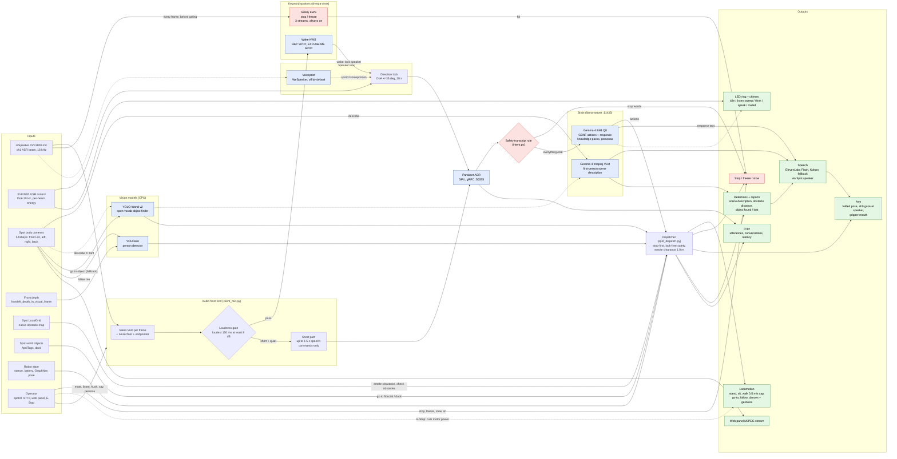

# System Diagram

Every input, through the models and features, to what Spot does, on the poster-demo branch (`demo-poster-2026-10-29`). Solid arrows are the live path; dotted arrows are optional, off by default, or fallbacks. Stage detail with file references is in the [pipeline explainer](pipeline-explainer.md); current state is in [status.md](../project/status.md).

PNG renders: [wide](system-diagram.png) (slides/poster) and [tall](system-diagram-tall.png) (screen reading). Re-render after editing the mermaid source below.

## Notes

- **Safety runs beside everything else.** The safety KWS gets every mic frame before the gate, wake word, or mute, and goes straight to stop/freeze. The transcript rule catches stop words ASR heard. Spot never says stop/halt/freeze aloud, so its own voice can't trigger them.
- **Native perception, no cameras:** emote clearance and "check obstacles" read Spot's LocalGrid; fiducial and dock go-to read Spot's world objects (AprilTags). Only follow mode uses depth.
- **Go to object** tries saved GraphNav locations first, then fiducial/dock, and only then the YOLO-World camera search.
- **Not used at runtime:** the hand camera, image grasp, ray-cast helpers and the camera-intrinsics helpers. The XVF3800 AEC does nothing because TTS plays through the Spot speaker, not the mic's own output.
- **Follow mode** (YOLOv8n on fisheye) is unreliable. GPU YOLO26 vision lives on `vision/perception-v2`, not this branch.
